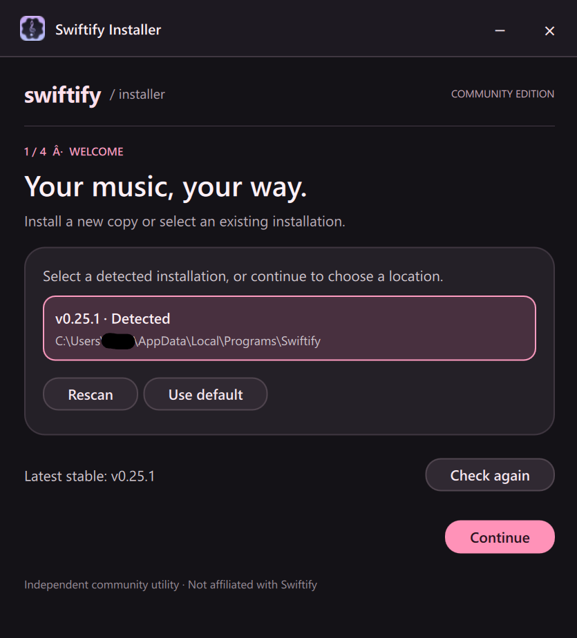

 <div align="center">


# Swiftify Installer

**A simpler way to install and update Swiftify on Windows.**

An unofficial, community-made installer for [Swiftify](https://github.com/swiftify-org/swiftify).

[](#)
[](#)
[](LICENSE)

**[download](#installation) · [features](#features) · [development](#development) · [contributing](CONTRIBUTING.md)**



<sub>Not affiliated with, endorsed by, or sponsored by the Swiftify project or its maintainers.</sub>

</div>

## about

Swiftify is a lightweight desktop Spotify player built with Qt Quick and Rust. However, installing it on Windows currently involves manually downloading and managing release archives.

Swiftify Installer aims to make that process a little less tedious.

It handles installation detection, downloading, installation, and updates through a straightforward graphical interface. You choose where Swiftify lives, and the installer takes care of the rest.

## features

- **Installation detection** — Finds existing Swiftify installations without scanning your entire drive.
- **Straightforward installation** — Downloads the appropriate stable Windows release and installs it to your chosen location.
- **Updates** — Updates existing installations while preserving untracked files and maintaining backups.
- **Start Menu integration** — Creates shortcuts for installations managed by the installer.
- **Integrity validation** — Checks downloaded archives and installation contents before proceeding.
- **Recovery handling** — Detects certain interrupted installation operations and handles recovery when needed.

## installation

<sub>Windows 10 and 11 · x86_64</sub>

1. Open the [latest release](https://github.com/YOUR_USERNAME/swiftify-installer/releases/latest).
2. Download the Windows x86_64 installer package.
3. Run the included installer executable.
4. Choose an installation destination or select an existing Swiftify installation.
5. Follow the installation wizard.

The installer downloads Swiftify directly from its upstream GitHub releases.

### requirements

- Windows 10 or Windows 11.
- A 64-bit x86 processor.
- An internet connection for downloading Swiftify releases.

Windows on ARM and 32-bit Windows are not currently supported.

## how it works

Swiftify Installer uses the official Swiftify GitHub releases as its source for application files.

During installation, it:

1. Retrieves the latest compatible stable release.
2. Downloads the Windows x86_64 archive.
3. Validates the archive and its contents.
4. Prepares the installation in a staging directory.
5. Installs or updates Swiftify at the selected destination.
6. Registers installer-managed metadata and creates a Start Menu shortcut.

Existing installations are inspected before being modified. Unrecognized or potentially unsafe destinations are not automatically deleted or overwritten.

### installation safety

The installer performs several checks to avoid accidentally damaging existing files:

- Validates archive paths and rejects unsafe archive entries.
- Checks archive integrity using CRC32.
- Validates managed installation contents.
- Uses a staging workspace before replacing an existing installation.
- Maintains backups during updates.
- Refuses to modify certain conflicting or unrecognized destinations.

CRC32 is used to detect accidental corruption. It does **not** authenticate the publisher or provide cryptographic verification of release authenticity.

## known limitations

This project is still evolving. Some functionality is intentionally outside its current scope.

- Windows x86_64 is the only supported target.
- Only one community installer registration is supported at a time.
- A dedicated uninstallation interface is not implemented.
- Automatic update checks are not implemented.
- Desktop shortcuts are not currently supported.
- UAC elevation is not implemented.
- The installer relies on upstream GitHub releases over HTTPS.
- Old backups and interrupted installation workspaces may be retained rather than automatically removed.

## development

The application uses a Qt Quick frontend with a Rust backend.

### prerequisites

- Windows 10 or 11.
- A stable Rust toolchain.
- A compatible Qt 6 installation and its required development components.
- A compatible MSVC toolchain.
- CMake and Ninja, if required by the current build configuration.

### building

Clone the repository:

```powershell
git clone https://github.com/YOUR_USERNAME/swiftify-installer.git
Set-Location swiftify-installer
```

Build instructions and the required Qt configuration are maintained alongside the project source. Refer to the current build configuration before building, as the Qt frontend and Rust backend must use compatible toolchains.

Run the Rust test suite:

```powershell
cargo test
```

Build artifacts are generated in:

```text
target/release/
```

## contributing

Contributions, bug reports, suggestions, and constructive criticism are welcome.

Before opening a pull request, please read [CONTRIBUTING.md](CONTRIBUTING.md).

For security-related reports, see [SECURITY.md](SECURITY.md).

## acknowledgements

- [Swiftify](https://github.com/swiftify-org/swiftify) — The application this installer was made for.
- [librespot](https://github.com/librespot-org/librespot) — The Spotify Connect implementation used by Swiftify.
- [Qt](https://www.qt.io/) — The framework behind the graphical interface.
- [Rust](https://www.rust-lang.org/) — The language powering the installation backend.

## license

This project is licensed under the [MIT License](LICENSE).

Third-party dependencies remain subject to their respective licenses.

Swiftify's name, branding, source code, releases, and assets belong to their respective owners and are not relicensed by this project.

